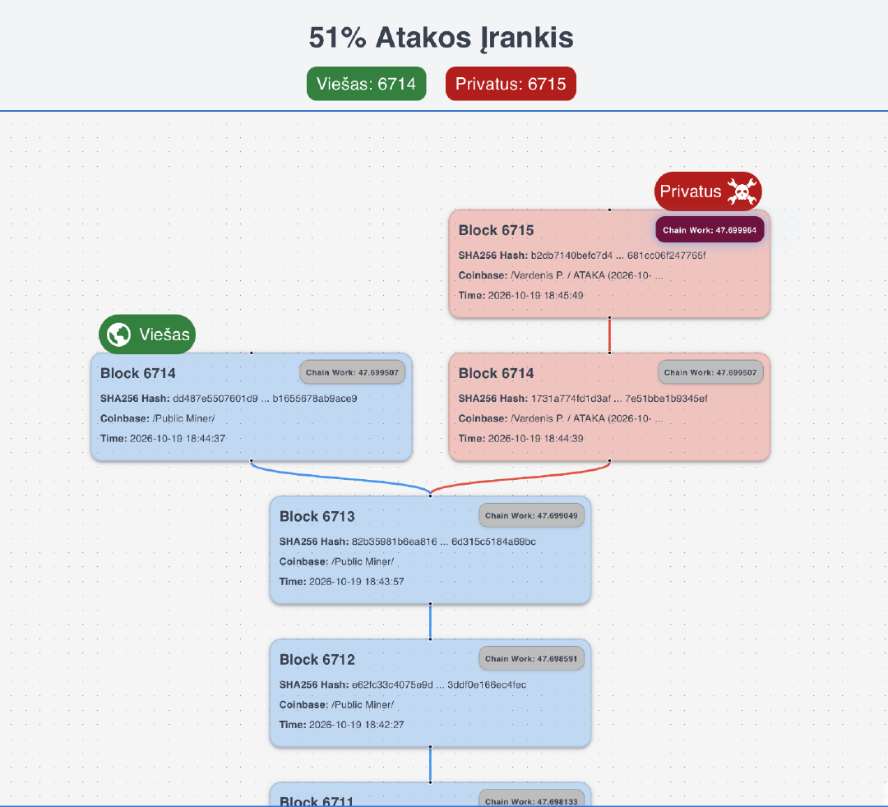
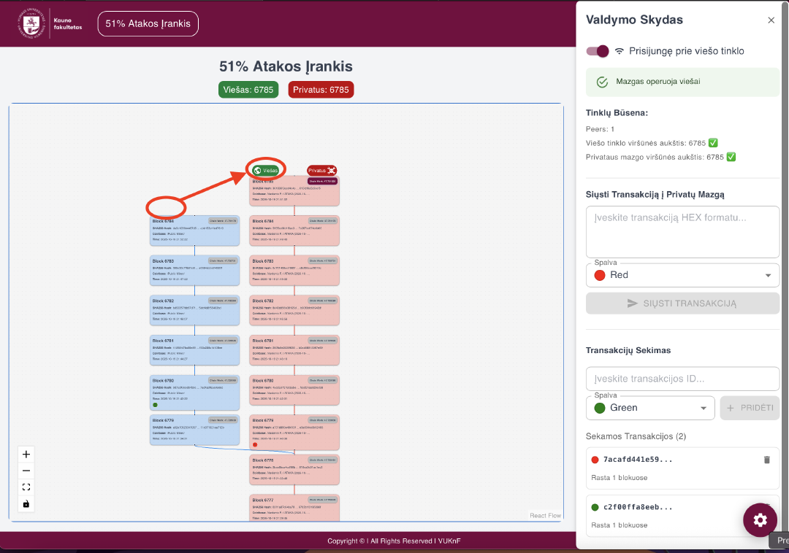

# 51% Attack Tool

Watch a 51% attack happen on a real blockchain. The tool runs two KNF Coin
full nodes, one on the public network and one private, and draws both chains
live in the browser. Cut the private node off, out-mine the public network
in secret, reconnect, and watch the network throw away its own blocks in
favour of yours.

Built for blockchain security classes at Vilnius University Kaunas Faculty.



## How an attack plays out

1. **Detach.** Open the control panel (the gear in the bottom right corner)
   and switch the private node off the public network. From then on it only
   knows the blocks it mines itself.
2. **Mine in secret.** Point a scrypt miner at the stack's stratum on port
   3333. Your blocks stack up in red on the right while the public network
   keeps mining blue blocks on the left.
3. **Spend twice** (optional). Pay someone on the public chain, then send a
   conflicting transaction, the same coins back to yourself, into the
   private node from the control panel. Track both transactions to see
   which blocks carry them.
4. **Reconnect.** Once your fork has more accumulated work (its chip
   glows), switch the private node back on. The public node drops its own
   blocks, adopts yours, and the payment it had confirmed is gone.



Blocks whose coinbase says `/Public Miner/` are drawn blue as the honest
chain; every other block counts as the attacker's and is drawn red.

## Run it yourself

All you need is Docker with Compose. To actually win, you also need more
scrypt hash power than the public KNF Coin network, and a rented rig will
do.

```sh
cp docker-compose.sample.yml docker-compose.yml
# set REWARD_ADDR (a KNF Coin address) under reorg-stratum
./runUpdateThisStack.sh
```

Then open `http://localhost/`. On the first start the public node needs a
little while to download the chain; switch the private node on in the
control panel so it catches up too, and you are ready to detach.

## What's inside

| Service | What it does |
|---|---|
| `reorg-endpoint` | Caddy on port 80: `/api` goes to the backend, everything else to the page |
| `reorg-vite` | The React page: the fork diagram and the control panel |
| `reorg-backend` | Flask API: reads both nodes, keeps the block history in SQLite, flips the private node's connection |
| `reorg-knfcoind-public` | KNF Coin full node on the public network |
| `reorg-knfcoind-private` | KNF Coin full node the attacker mines on |
| `reorg-stratum` | [AnyPool](https://hub.docker.com/r/vuknf/anypool-stratum) mining server on port 3333, feeding the private node |

The database and both chains live in `_DATA/`.

## Working on it

The sample runs the published Docker Hub images. To change the code, switch
`reorg-vite` and `reorg-backend` to the self-built, source-mounted variants
commented in `docker-compose.sample.yml`, and your edits reload live. Each
side has its own test suite that runs in a throwaway container:
`backend/runTests.sh` and `vite/runTests.sh`.
